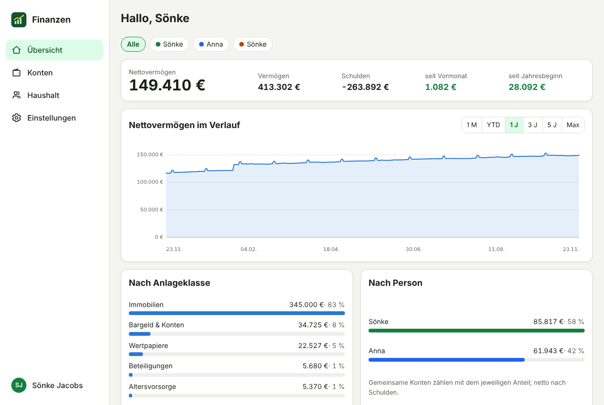
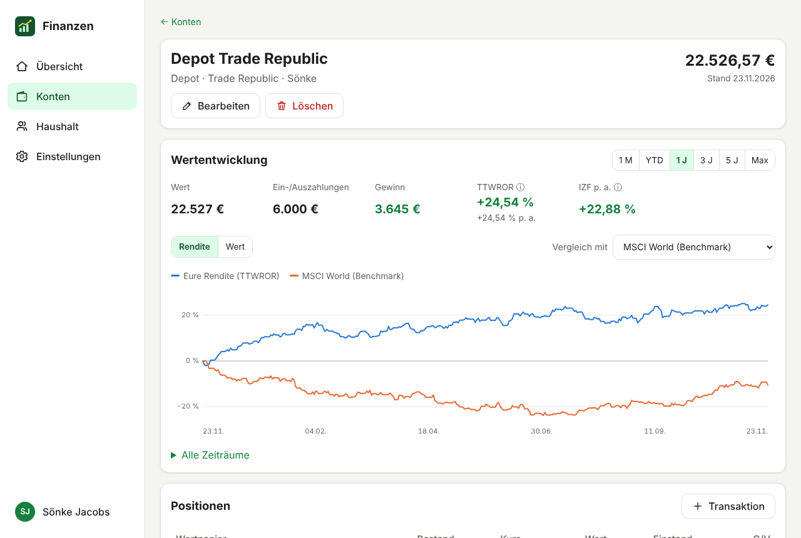
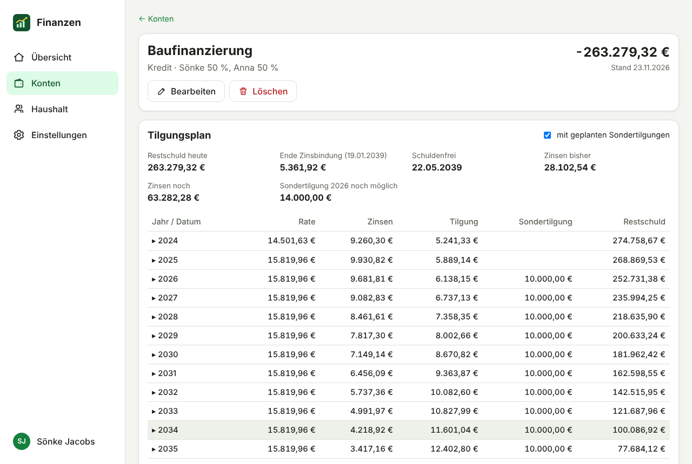
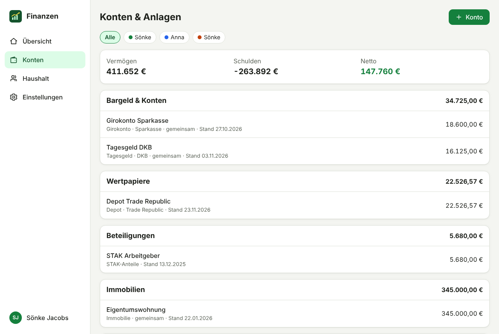

# Finanzen 📈

Finanzen ist der Finanzüberblick für euren Haushalt: das Girokonto bei der
Sparkasse, das Tagesgeld bei der DKB, das Depot bei Trade Republic, die
STAK-Anteile vom Arbeitgeber, die Wohnung samt Kredit und der Goldbarren im
Schrank – alles an einem Ort, mit Verlauf und ehrlicher Rendite.

Kurz gesagt: einmal reinschauen und wissen, wo ihr steht – und ob euer Depot
besser läuft als der MSCI World.

> **Stand:** Konten, Depots, alle Anlageformen, Tilgungsplan, tägliche Kurse,
> Rendite, Dashboard mit Benchmark, Bankanbindung per FinTS, CSV-Import (Bank
> und Portfolio Performance), Export und tägliche Sicherung sind fertig. Als
> Nächstes: Importer für Trade Republic und Advanzia sowie
> Benachrichtigungen – siehe [docs/ANFORDERUNGEN.md](docs/ANFORDERUNGEN.md).

| Übersicht | Depot | Kredit | Konten |
| --- | --- | --- | --- |
|  |  |  |  |

<sub>Screenshots mit Beispieldaten.</sub>

## Was Finanzen für dich machen wird

- **Alles in einer Summe** – Konten, Depots, Immobilien, Krypto, Gold,
  Altersvorsorge und Kredite ergeben euer Nettovermögen, mit Verlauf über die
  Jahre.
- **Rendite, die stimmt** – zeitgewichtet (TTWROR) und geldgewichtet (IZF),
  damit Sparpläne und Entnahmen das Ergebnis nicht verfälschen.
- **Direkt von der Bank** – Sparkasse, DKB und OLB per FinTS; Trade Republic,
  die Bitcoins bei BSDEX und die Advanzia-Kreditkarte per Import.
- **Kurse von selbst** – täglich über onvista oder Yahoo Finance, per ISIN,
  mit automatischer Ausweichquelle.
- **Für den ganzen Haushalt** – jede Person meldet sich selbst an, Konten
  gehören einer Person oder euch gemeinsam.
- **Für sich bleiben** – läuft auf eurem eigenen Server, keine Cloud, kein
  Tracking. Bank-PINs werden nur gespeichert, wenn du das willst, und dann
  verschlüsselt.
- **Als App installieren** – Finanzen ist eine PWA und funktioniert auf dem
  Handy wie eine App.

## Für wen ist das?

Finanzen passt zu dir, wenn du ...

- Konten und Depots bei mehreren Banken hast und den Überblick in einer
  Tabelle satt bist,
- wissen willst, was dein Depot wirklich bringt – nicht nur „+12 %“,
- auch Dinge wie Immobilien, Mitarbeiterbeteiligungen oder Gold mitzählen willst,
- selbst hostest und deine Finanzdaten nicht bei einem Fremden ablegen willst.

## Schnellstart mit Docker

Auf garageband die Ordner anlegen – das Datenverzeichnis gehört dem Benutzer
im Container (UID 10001):

```bash
sudo mkdir -p /data/container/finanzen/data /data/container/finanzen/db
```

```bash
sudo chown 10001:10001 /data/container/finanzen/data
```

Vorlagen kopieren:

```bash
cp .env.example .env
```

```bash
cp compose.example.yml compose.yml
```

In `.env` mindestens `PUBLIC_URL`, `POSTGRES_PASSWORD` (`openssl rand -hex 32`),
`SESSION_KEY` (`openssl rand -base64 32`), `OIDC_ISSUER` und `OIDC_CLIENT_ID`
ausfüllen (siehe „Login über OIDC“ unten), dann:

```bash
docker compose up -d
```

```bash
docker compose ps
```

`finanzen` und `finanzen-db` zeigen nach ein paar Sekunden „healthy“. Die App
lauscht auf Port **43651** (innen und außen gleich), das Image ist
`ghcr.io/doenke/finanzen:latest`.

## Ein erster Rundgang

### 1. Anmelden

`https://finanzen.kanonenwiese.de` öffnen und auf „Mit Kanonenwiese SSO
anmelden“ tippen. Wer sich zum ersten Mal anmeldet, landet automatisch im
Haushalt – mit Vornamen und Profilbild aus Pocket ID.

### 2. Haushalt vervollständigen

Unter **Haushalt** steht jede Person, die sich schon einmal angemeldet hat.
Kinder oder andere Personen ohne eigenen Login legst du dort mit „+ Person“ an,
damit du ihnen später Konten und Anlagen zuordnen kannst. Jede Person bekommt
eine Farbe, die später in Diagrammen wieder auftaucht.

### 3. Konten und Anlagen anlegen

Unter **Konten** legst du mit „+ Konto“ alles an, was Wert hat – oder kostet:

- **Girokonto, Tagesgeld, Kreditkarte:** einen Kontostand zu einem Stichtag
  eintragen, spätere Umsätze werden darauf gerechnet. Ein Stand im Monat
  reicht auch.
- **Depot, Krypto, STAK-Anteile, Edelmetalle:** Käufe, Verkäufe und
  Dividenden als Transaktionen erfassen, Bestand und Einstand (FIFO) rechnet
  Finanzen selbst. Für STAK-Zertifikate trägst du den festgesetzten Kurs je
  Periode beim Wertpapier ein; er gilt bis zum nächsten Eintrag. Beim Gold
  zählt der Feingehalt mit.
- **Immobilie, Altersvorsorge, Sonstiges:** Schätzwert oder Wert aus der
  Standmitteilung zu Stichtagen, dazu Beiträge oder Mieteinnahmen.
- **Festgeld:** Betrag, Zins und Laufzeit – der Wert wird bis zur Fälligkeit
  aufgezinst.
- **Kredit:** Darlehensbetrag, Zins, Tilgung oder Rate und erste Rate – daraus
  entsteht der **Tilgungsplan** mit Restschuld zum Ende der Zinsbindung,
  Zinsen bisher und noch, Schuldenfrei-Datum und CSV-Export. Geplante
  Sondertilgungen (z. B. jedes Jahr im Dezember) fließen ein, das
  Sondertilgungsrecht wird überwacht. Trägst du die Restschuld aus dem
  Kontoauszug ein, rechnet der Plan ab dort weiter.
  Hat sich die Rate geändert – oder wird sie es? Unter **Ratenänderungen**
  trägst du ab einem Datum die neue Rate ein, auch rückwirkend; Restschuld,
  Verlauf und Szenarien rechnen damit.
  Unter **Szenarien** spielst du durch, was wäre, wenn: geplante oder
  zusätzliche Sondertilgungen, eine höhere Rate ab einem Stichtag oder ein
  anderer Zins nach der Zinsbindung. Bis zu vier Varianten stehen neben dem
  Plan ohne Sondertilgungen – mit Schuldenfrei-Datum, Restschuld zum Ende der
  Zinsbindung, Zinsersparnis und wie viel früher ihr fertig seid.

**Kurse:** Beim Anlegen eines Wertpapiers suchst du es per ISIN oder Name –
standardmäßig bei **onvista**, das Aktien, ETFs, Fonds, Anleihen, Krypto und
Edelmetalle kennt und gleich einen Euro-Handelsplatz (Xetra, Tradegate, …)
wählt. Yahoo Finance gibt es weiter als Alternative (z. B. `EUNL.DE`); blockiert
Yahoo, springt onvista über die ISIN automatisch ein. Unter **Einstellungen**
stellst du alle bisherigen Yahoo-Wertpapiere mit einem Klick auf onvista um.
Die Historie ab dem ersten Kauf wird sofort geladen, danach kommt jeden
Werktag um 23:30 Uhr der Schlusskurs dazu. Kurse, die älter als drei
Handelstage sind, werden als „veraltet“ markiert.

Jedes Konto gehört einer Person oder mehreren mit Anteilen. Oben in der
Kontenliste filterst du nach Person – gemeinsame Konten zählen dann mit dem
jeweiligen Anteil.

### 4. Wissen, wo ihr steht

Die **Übersicht** zeigt euer Nettovermögen, die Veränderung seit Vormonat und
Jahresbeginn, den Verlauf und die Aufteilung nach Anlageklasse und Person.
Darunter steht die Rendite eurer Anlagen – als **TTWROR** (wie gut die
Anlagen selbst gelaufen sind, egal wann ihr Geld eingezahlt habt) und als
**IZF** (eure persönliche Rendite pro Jahr, mit Timing). Wähl einen
Vergleichswert, etwa einen MSCI-World-ETF, und Finanzen legt dessen Verlauf
daneben. Dieselbe Auswertung gibt es für jedes einzelne Konto und Depot, mit
allen Zeiträumen von einem Monat bis „seit Beginn“.

So rechnet Finanzen:

- Käufe, Verkäufe, Beiträge und Einzahlungen sind Ein- und Auszahlungen und
  zählen nicht als Gewinn. Dividenden, Zinsen und Kursgewinne schon.
- Umbuchungen innerhalb des Haushalts – Girokonto aufs Depot – heben sich in
  der Gesamtsicht auf.
- Bei Immobilien und Altersvorsorge gilt zwischen zwei Bewertungen der letzte
  Wert plus die Beiträge seither.
- Kredite stecken im Nettovermögen, aber nicht in der Rendite.

### 5. Bank verbinden (FinTS)

Unter **Banken** legst du mit „+ Bankzugang“ den Zugang zu Sparkasse, DKB,
OLB & Co. an: Bankleitzahl, FinTS-Adresse und Anmeldename wie im
Online-Banking. Finanzen fragt dann nach der PIN, lässt dich das
TAN-Verfahren wählen und zeigt die Konten, die die Bank kennt. Du
entscheidest je Konto: neu anlegen, mit einem vorhandenen verknüpfen oder
weglassen.

- **Aktualisieren** holt Salden, Umsätze (beim ersten Mal 90 Tage) und
  Depotbestände. Verlangt die Bank eine TAN, erscheint sie im Dialog –
  pushTAN und App-Freigaben bestätigst du einfach in der Banking-App,
  photoTAN scannst du vom Bildschirm, beim chipTAN gibst du die TAN aus der
  manuellen Eingabe ein (Flickercode wird nicht angezeigt).
- **PIN speichern** ist freiwillig. Ohne gespeicherte PIN fragt Finanzen bei
  jedem Abruf. Mit gespeicherter PIN (verschlüsselt mit `SECRETS_KEY`) kann
  Finanzen jede Nacht selbst abrufen; braucht die Bank alle 90 Tage eine
  TAN-Freigabe, siehst du unter Banken einen Hinweis.
- **Depots:** Beim ersten Abruf übernimmt Finanzen den Bestand zum
  Einstandskurs laut Bank. Später zeigt es Abweichungen zwischen Bank und
  deinen Transaktionen – meist fehlt ein Kauf – und bucht sie auf Wunsch als
  Ein- oder Auslieferung.

### 6. Umsätze und Depots importieren

Unter **Konten → Import** liest Finanzen den CSV-Export deiner Bank
(Sparkasse „CSV-CAMT“, DKB, OLB, …), Exporte aus **Portfolio
Performance** und die Transaktionsliste von **BSDEX**. Bei BSDEX landen
ausgeführte Käufe und Verkäufe im Krypto-Depot, Einzahlungen und der
Euro-Anteil jeder Order auf dessen Verrechnungskonto – so stimmen Bitcoin-Bestand,
Einstand inklusive Gebühren und das Euro-Guthaben bei der Börse. Du siehst vorher, was neu ist, was schon da ist und was nicht
passt. Spaltenzuordnungen speicherst du als Vorlage, doppelte Buchungen
werden übersprungen, und jeder Import lässt sich mit einem Klick komplett
rückgängig machen. Beim Portfolio-Performance-Import werden fehlende
Wertpapiere gleich mit angelegt – samt Kurshistorie ab dem ersten Kauf.

### 7. Zum Startbildschirm hinzufügen

Im Browsermenü „Zum Startbildschirm hinzufügen“ bzw. „App installieren“
wählen. Unter **Einstellungen** schaltest du zwischen hell, dunkel und
„wie das System“ um.

## Login über OIDC

Finanzen hat keine eigenen Passwörter – angemeldet wird über Pocket ID.

1. In Pocket ID einen OIDC-Client **finanzen** anlegen.
2. Callback-URL: `https://finanzen.kanonenwiese.de/auth/callback`
3. **Public Client** mit PKCE (ohne Secret). Bei einem vertraulichen Client
   das Secret in `OIDC_CLIENT_SECRET` eintragen.
4. Unter „Allowed User Groups“ nur die Gruppe eures Haushalts zulassen – wer
   nicht drin ist, kommt gar nicht erst bis zur App.
5. Client-ID in `OIDC_CLIENT_ID`, `https://id.kanonenwiese.de` in
   `OIDC_ISSUER`.

Wer in der Gruppe `admins` ist (`OIDC_ADMIN_GROUP`), bekommt später die
Admin-Funktionen wie Systemeinstellungen und Backup. Das Profilbild aus Pocket
ID wird beim Login einmal geladen und von Finanzen selbst ausgeliefert.

## Kleine Konfiguration, große Wirkung

| Einstellung | Wofür? |
| --- | --- |
| `PUBLIC_URL` | Öffentliche Adresse, z. B. `https://finanzen.kanonenwiese.de` |
| `POSTGRES_PASSWORD` | Passwort der Datenbank (nur Buchstaben und Ziffern) |
| `SESSION_KEY` | Signiert die Anmeldung; ändern meldet alle ab |
| `SECRETS_KEY` | Verschlüsselt gespeicherte Bank-PINs – **nie ändern, gut aufheben** |
| `OIDC_ISSUER`, `OIDC_CLIENT_ID` | Anmeldung über Pocket ID |
| `FINTS_PRODUCT_ID` | Registrierungsnummer für FinTS (Deutsche Kreditwirtschaft) |

Alle Werte mit Erklärung stehen in [.env.example](.env.example). Was dort
schon drinsteht, aber noch nicht genutzt wird, ist entsprechend markiert.

---

## Betriebsecke

### Reverse Proxy (z. B. Nginx Proxy Manager)

Einen Proxy Host `finanzen.kanonenwiese.de` auf `http://garageband:43651`
anlegen, dann:

- **Force SSL** einschalten – ohne HTTPS keine installierbare App und keine
  sichere Anmeldung.
- **HTTP/2** und **HSTS** dürfen an.

Für DNS und Firewall gibt es den n8n-Provisioning-Workflow (Name `finanzen`,
Port `43651`).

### Wichtige Hinweise für den Betrieb

- **Healthcheck:** `https://finanzen.kanonenwiese.de/healthz` – 200 mit
  Version, wenn Datenbank und Datenverzeichnis passen, sonst 503 mit dem
  betroffenen Teil. Gut für Uptime Kuma. `/healthz/live` meldet nur, dass der
  Prozess läuft.
- **Version:** steht unter Einstellungen und in `/healthz`, Schema x.yy.zzz.
- **Updates:** `docker compose pull && docker compose up -d`. Datenbank-Migrationen
  laufen beim Start von selbst, die App im Browser holt sich die neue Version still.
- **`DEV_LOGIN=true`** erlaubt die Anmeldung nur mit einem Namen, ohne Pocket ID –
  **niemals in Produktion**.
- **Backup:** Finanzen schreibt jede Nacht um 3:30 Uhr eine Sicherung aller
  Daten nach `/data/container/finanzen/data/backup/` (`BACKUP_SCHEDULE`,
  `BACKUP_KEEP_DAYS`). Admins sehen sie unter Einstellungen und können dort
  auch sofort sichern. Diesen Ordner zusätzlich auf ein anderes Gerät
  kopieren. Wiederherstellen in eine frische Datenbank (gleiche App-Version):

  ```bash
  docker compose run --rm app python -m finanzen restore /data/backup/finanzen-2026-11-23_0330.json.gz
  ```

- **Image privat?** Ist das Paket auf ghcr.io privat, auf garageband einmal
  `docker login ghcr.io` mit einem Token (Scope `read:packages`) ausführen
  oder das Paket in GitHub auf „public“ stellen.
- **`SECRETS_KEY`** nach dem ersten Speichern einer PIN nie mehr ändern und
  getrennt vom Backup aufbewahren.

## Lizenz

[MIT](LICENSE)
